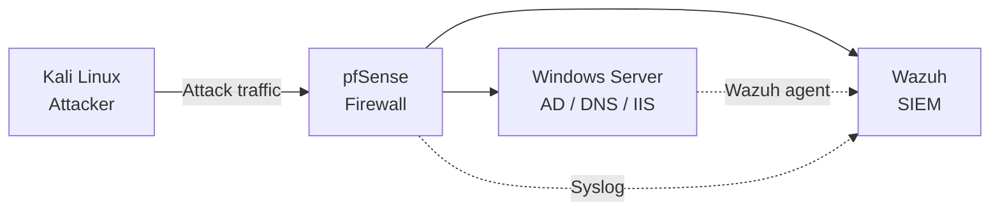

# SIEM – Security Incident Detection and Management with Wazuh

> Deployment of a **Wazuh** SIEM in a virtualized lab simulating an enterprise infrastructure, in order to centralize logs, correlate events and detect simulated attacks.
> Multidisciplinary project – 4th year Network Engineering.

---

## Table of Contents

- [Overview](#overview)
- [Architecture](#architecture)
- [Technologies](#technologies)
- [Custom Detection Rules](#custom-detection-rules)
- [Attack Scenarios](#attack-scenarios)
- [Results](#results)
- [Repository Structure](#repository-structure)
- [Full Report](#full-report)
- [Author](#author)

---

## Overview

In a traditional infrastructure, firewalls and Active Directory generate separate logs: data is **scattered**, there is **no correlation** between events, and **continuous monitoring** is limited.

This project addresses the following question:

> To what extent does integrating Wazuh improve security log management through centralization, correlation and continuous configuration auditing?

Four attacks are simulated from a Kali Linux machine: **brute force, denial of service, privilege escalation and network scanning**. For each one, we verify that Wazuh collects the logs, triggers an alert and displays it in its dashboard.

---

## Architecture

The lab consists of four virtual machines on an internal network. All traffic goes through the firewall.

| VM | Role | OS | IP (indicative) |
| --- | --- | --- | --- |
| **VM-SIEM** | Wazuh (manager, indexer, dashboard) | Ubuntu Server | `192.168.1.30` |
| **VM-AD** | Active Directory, DNS, IIS web portal | Windows Server | `192.168.1.20` |
| **VM-FW** | Firewall and traffic filtering | pfSense | `192.168.1.1` |
| **VM-ATT** | Attacker machine | Kali Linux | `192.168.1.10` |



- A **Wazuh agent** installed on the Windows Server forwards its security logs to the manager.
- **pfSense firewall logs** are sent to the Wazuh server for analysis and correlation.
- Active Directory contains **6 organizational units** (departments) and **30 fictitious user accounts**.
- pfSense filtering rules: HTTP (80), HTTPS (443) and SSH (22) allowed, everything else blocked.

---

## Technologies

- **Wazuh** – SIEM (manager, indexer, dashboard, agent)
- **Windows Server** – Active Directory, DNS, IIS
- **pfSense** – firewall
- **Ubuntu Server** – SIEM host
- **Kali Linux** – attack simulation
- **Hydra** – brute force
- **hping3** – denial of service (SYN flood)
- **VMware Workstation** – virtualization

---

## Custom Detection Rules

Rules are defined in [`wazuh/local_rules.xml`](wazuh/local_rules.xml) to raise alert severity according to context:

| Rule | Purpose |
| --- | --- |
| `100001` | Sensitive account in Windows logs |
| `100002` | Compromised password found by Hydra |
| `100003` | Default Administrator account monitoring |
| `100004` | Access to a critical system directory (`System32`) |
| `100005` | SMB port access attempt (lateral movement) |
| `100006` | RDP connection attempt (port 3389) |
| `100007` | `cmd.exe` execution |
| `100008` | PowerShell execution |
| `100009` | Generic authentication failure (French locale) |
| `103005` | Network activity intercepted by the pfSense firewall |

Example:

```xml
<rule id="100005" level="10" overwrite="yes">
  <match>445</match>
  <description>PFE Rule 5: SMB port access attempt (file sharing), often used for lateral movement.</description>
</rule>
```

---

## Attack Scenarios

Each scenario is launched from Kali Linux and verified in the Wazuh dashboard.

### 1. Brute Force (Hydra)
- **Target:** Active Directory authentication service
- **Log source:** Windows Event ID `4625` (failed logon)
- **Detection:** Wazuh rule `60122` – *Logon failure – Unknown user or bad password* (level 5); spike of failed attempts visible in the dashboard
- An alert `92657` (suspicious remote NTLM logon) also appeared during the test.

### 2. Denial of Service (SYN flood, hping3)
- **Detection:** sharp increase in firewall events (rule `103005`) in the dashboard, high-severity alerts.
- **Remediation:** the source IP is blocked with a pfSense rule, which stops the attack.

### 3. Privilege Escalation
- **Scenario:** a standard domain user obtains administrator rights on the domain controller.
- **Detection:** Wazuh alert reporting an abnormal privilege elevation.

### 4. Network Scan
- **Detection:** high number of requests to multiple IPs and ports, seen in firewall logs (rule `103005`) and a reconnaissance alert in Wazuh.

---

## Results

| Scenario | Tool | Detection source | Detected |
| --- | --- | --- | --- |
| Brute force | Hydra | Windows logs (agent) – rule `60122` | ✅ |
| Denial of service | hping3 | Firewall logs – rule `103005` | ✅ |
| Privilege escalation | Standard account → admin | Windows logs (agent) | ✅ |
| Network scan | Kali Linux | Firewall logs – rule `103005` | ✅ |

What the lab demonstrates:
- Centralization of logs (Active Directory + firewall) in a single point
- Real-time alert visualization
- Complementarity between the **SIEM** (detect) and the **firewall** (block)

---

## Repository Structure

```
siem-wazuh-lab/
├── README.md
├── LICENSE
├── docs/
│   └── SIEM_anonymise.pdf      # full report (in French)
├── images/                      # architecture + alert screenshots
└── wazuh/
    └── local_rules.xml          # custom rules
```

---

## Full Report

The full thesis (in French) covers the study of the existing setup, SIEM fundamentals, the choice of Wazuh and all attack scenarios: [`docs/SIEM_anonymise.pdf`](docs/SIEM_anonymise.pdf)

---

## Author

**KADI Massilva** – Network Engineering student

---

*Project carried out as part of a cybersecurity course: SIEM, log analysis and incident detection.*
